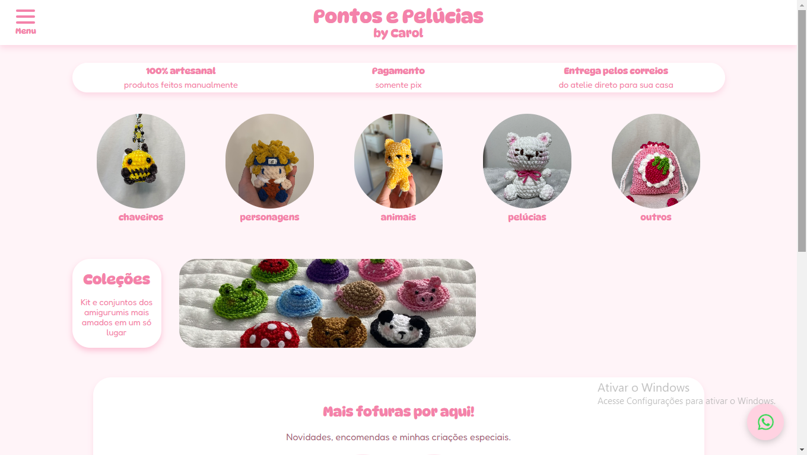
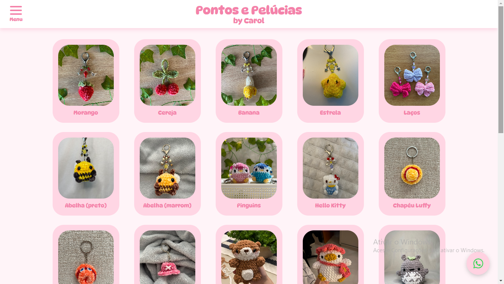
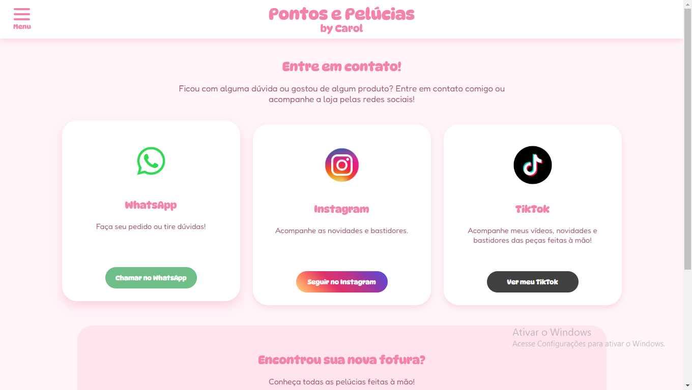
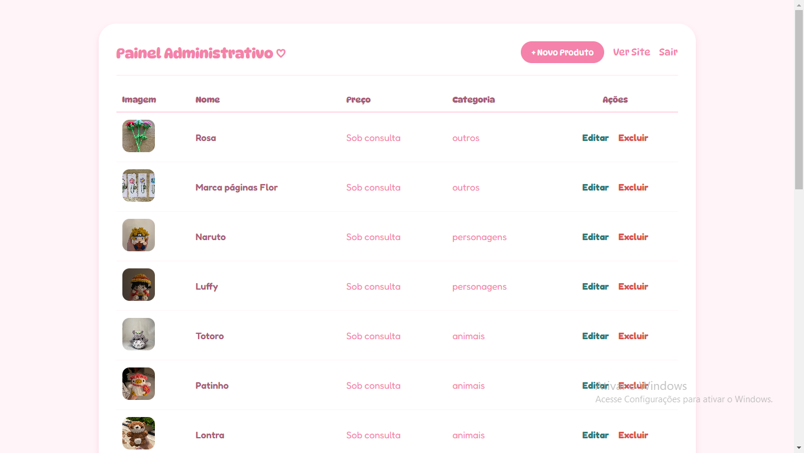

# Pontos e Pelúcias (by Carol)
## Objetivo do projeto

Desenvolver um site para divulgação e comercialização de pelúcias artesanais de crochê, facilitando o acesso dos clientes a informações sobre os produtos, como disponibilidade, preços e opções disponíveis. O site também possibilita que os clientes entrem em contato para realizar pedidos, contribuindo para ampliar as oportunidades de venda e divulgação da loja.

## Link para acesso ao site:
http://pontospelucias.wuaze.com/

## Link para acesso ao painel administrativo:
http://pontospelucias.wuaze.com/login_admin_certo.php

## Integrantes
Aline Betti Pedro Bom — RA: 202610206

Laís Freitas de Lima — RA: 202610214

Matheus Jean Chehade — RA: 202610228

Vitor Guadagnino — RA: 202610249

## Tecnologias utilizadas
PHP: desenvolvimento das funcionalidades e páginas dinâmicas.
HTML5: estruturação das páginas do site.
CSS3: estilização e organização do layout.
Apache: servidor web responsável por executar a aplicação.
MySQL/MariaDB: gerenciamento e armazenamento dos dados.
XAMPP: ambiente de desenvolvimento e execução local.

## Instalação, configuração e execução
### 1. Instalação
Faça o download e instale o XAMPP.
Abra o terminal ou CMD e acesse a pasta htdocs do XAMPP:
bash
cd C:\xampp\htdocs

Clone o repositório dentro dessa pasta:
bash
git clone <url-do-repositorio> PontosPelucias

### 2. Configuração do banco de dados
Abra o XAMPP Control Panel.
Inicie os serviços Apache e MySQL.
Acesse o phpMyAdmin.
Entre na aba Importar.
Selecione o arquivo banco/pontospelucias.sql, localizado no projeto.
Clique em Importar ou Executar para criar o banco de dados e suas respectivas tabelas.
Caso necessário, ajuste as credenciais de conexão com o banco de dados no arquivo includes/conexao.php.
Verifique se o banco de dados pontospelucias e as tabelas foram criados corretamente.
### 3. Execução do projeto

Após iniciar os serviços Apache e MySQL, utilize os seguintes endereços para acessar o sistema:

Acesso à loja:

http://localhost/PontosPelucias/

Acesso ao painel administrativo:

http://localhost/PontosPelucias/admin/login_admin.php

Para acessar o painel, informe as credenciais de uma conta de administrador cadastrada na tabela administradores do banco de dados.

O painel administrativo permite cadastrar, editar e excluir produtos. Todas as alterações são armazenadas diretamente no banco de dados MariaDB e refletidas no catálogo da loja.

Observação: O XAMPP deve permanecer em execução durante a utilização local do sistema, mantendo os serviços Apache e MySQL ativos.

## Principais funcionalidades
**- Visualização do catálogo:** permite que os clientes naveguem pelos produtos disponíveis na loja.

**- Detalhes dos produtos:** apresenta informações individuais, como nome, preço, imagens e opções disponíveis.

**- Contato com a responsável:** disponibiliza canais de comunicação para dúvidas, informações e realização de encomendas.

**- Autenticação administrativa:** permite que a responsável acesse o painel administrativo por meio de login e senha.

**- Gerenciamento de produtos:** possibilita cadastrar, editar e excluir produtos diretamente pelo painel administrativo.

**- Atualização dinâmica:** exibe no catálogo as informações armazenadas no banco de dados, refletindo as alterações realizadas no painel administrativo.

## Requisitos e depêndencias

Para o funcionamento do projeto, são necessários:

**- PHP 8.0 ou superior:** responsável pela execução das funcionalidades e páginas dinâmicas.

**- MySQL/MariaDB:** sistema de gerenciamento do banco de dados utilizado para armazenar as informações dos produtos e administradores.

**- Apache:** servidor web responsável por processar as requisições e disponibilizar o site.

**- phpMyAdmin:** ferramenta utilizada para importar, visualizar e gerenciar o banco de dados.

**- XAMPP:** ambiente necessário para execução local, disponibilizando Apache, PHP e MySQL/MariaDB.

**- Git:** necessário para clonar o repositório do projeto.

**- Navegador atualizado:** necessário para acessar e utilizar a loja e o painel administrativo.

**- Conexão com a internet:** necessária para acessar recursos externos e canais de contato, como WhatsApp e redes sociais.

## Link do repositório no GitHub:

https://github.com/l0b00/PontosPelucias.git

## Imagens

### Página inicial

### Cátalogo

### Página de contato

### Painel de controle

